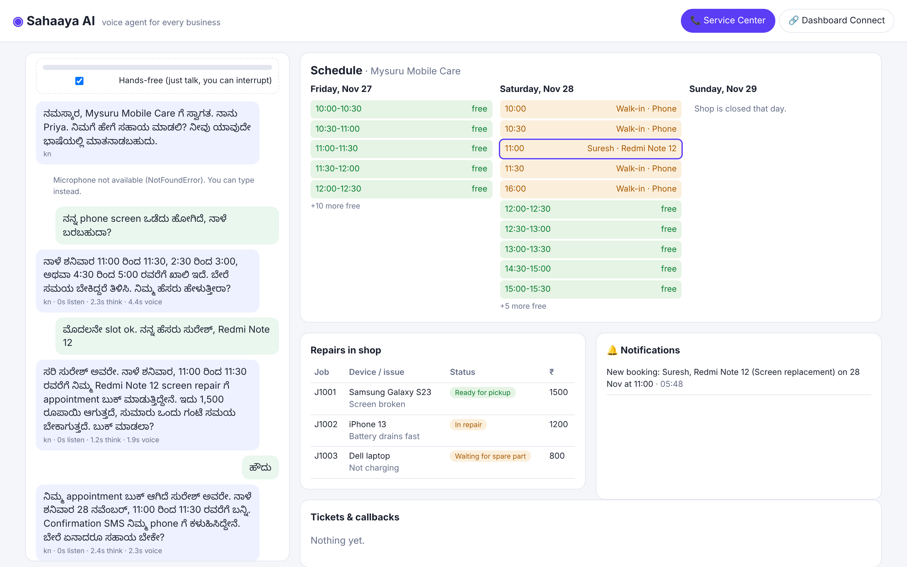
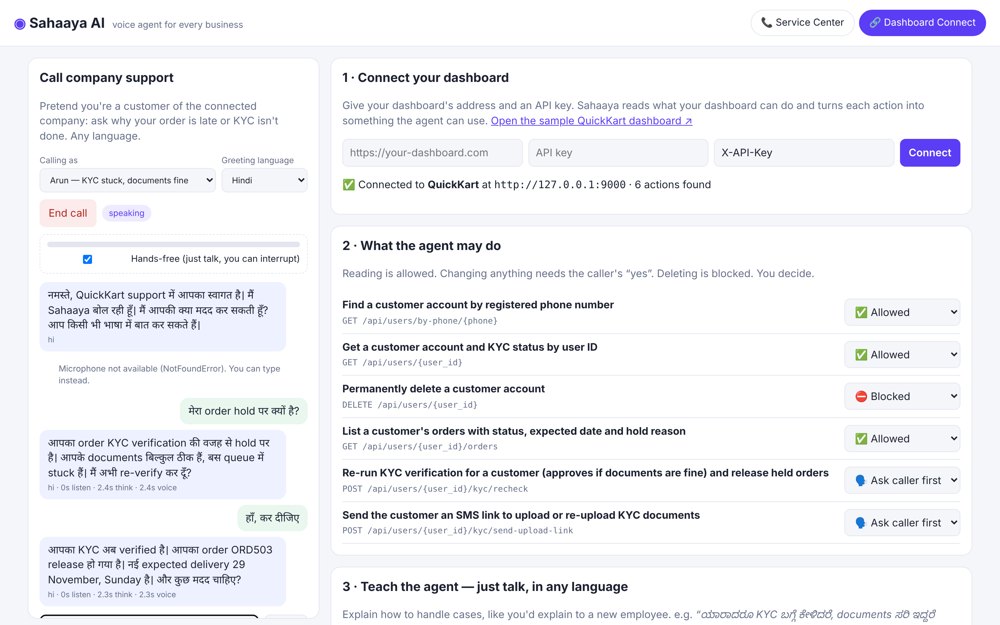
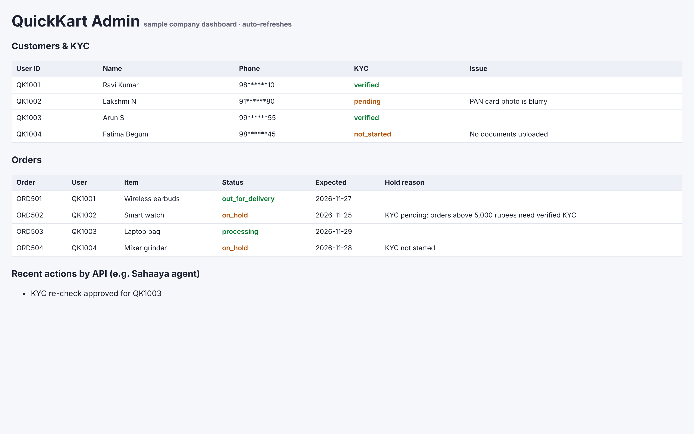
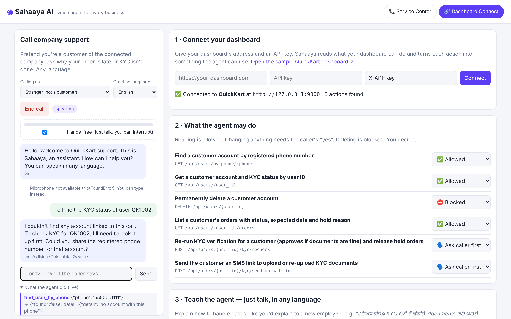

# Sahaaya AI — a multilingual voice agent for every business

Customers call and **talk in their own language** (English, Kannada, Hindi, Telugu, and mixed
speech like Kanglish/Hinglish). Sahaaya answers like a real person, **checks the business's real data**,
and **gets the job done**: books a slot, re-runs a KYC check, sends an upload link, or raises a ticket.

| Section | What it does | Example |
|---|---|---|
| 📞 **Service Center** | Voice receptionist for **any** small business (repair shop, kirana store, clinic, salon, restaurant, custom), set up by **talking to it** | "My phone screen broke, can I come tonight at 9?" → checks the schedule → books it → name, mobile and problem appear on the owner's dashboard |
| 🔗 **Dashboard Connect** | Plugs into **any** company's dashboard (API) or Google Sheet/CSV and works inside it | "Why is my order stuck? KYC pending?" → finds the account → documents fine → **re-runs KYC, order released** |

In Dashboard Connect the owner **teaches the agent by speaking, in any language**
("ಯಾರಾದರೂ KYC ಬಗ್ಗೆ ಕೇಳಿದರೆ… recheck ಮಾಡಿ"). Sahaaya turns it into clear rules, reads them back in the
owner's language, and uses them only after the owner approves.

## Screenshots

| Service Center: booking by voice in Kannada | Dashboard Connect: KYC fixed in Hindi |
|---|---|
|  |  |
| **Company dashboard after the agent acted** | **Stranger can't see others' data** |
|  |  |

More: [teach the agent by voice](docs/screenshots/2-teach-agent-by-voice.png) · [phone view](docs/screenshots/6-phone-view.png) ·
[pitch deck](docs/Sahaaya-AI-pitch-deck.pdf) · [accuracy results](eval/RESULTS.md)

## Run it (one command)

```bash
docker compose up --build
```

- App: http://localhost:8000
- Sample company dashboard (QuickKart, users/KYC/orders): http://localhost:9000

It **starts without any keys**. AI and voice show "key not set" until you add keys:

```bash
cp .env.example .env    # then add SARVAM_API_KEY (and optionally NVIDIA_API_KEY)
docker compose up --build
```

Without Docker: `pip install -r requirements.txt`, then run
`uvicorn sample_dashboard.main:app --port 9000` and
`DEMO_DASHBOARD_URL=http://127.0.0.1:9000 uvicorn app.main:app --port 8000`.

## Try it
1. **Service Center** tab → talk to the **setup assistant** (any language): *"I run a mobile repair shop. 1-hour slots,
   24/7, book customers with name, mobile and problem. If they ask the price, say please visit once for checking, then
   we give a quotation."* It asks follow-up questions and sets itself up. Then press **📞 Demo call** and say
   *"ನನ್ನ phone screen ಒಡೆದಿದೆ, ಇವತ್ತು ರಾತ್ರಿ 9 ಕ್ಕೆ ಬರಬಹುದಾ?"*. The booking appears under **Bookings**.
   Other businesses: pick a type (kirana store, clinic, salon, restaurant) or just describe yours.
2. **Dashboard Connect** tab → *Teach the agent*: hold the mic and explain a rule in any language → **Approve**.
3. Call as *"Arun — KYC stuck"* → *"मेरा order क्यों रुका है?"* → say yes → open the QuickKart
   dashboard: KYC is now **verified** and the order **processing**.
4. Call as *"Stranger"* and ask about someone else's account: nothing is revealed.

Use Chrome or Edge with a microphone. **Hands-free mode**: just talk, pause to finish, and talk over the
agent to interrupt it. Push-to-talk and typing work too.

## How it works

```
Caller (mic / phone) ─► Sarvam Saarika speech-to-text (auto language detection)
                     ─► Agent brain: Sarvam-105B (backup: NVIDIA Nemotron) with tool calling
                          ├─ Service Center tools: free slots, book, cancel, repair status, ticket
                          └─ Dashboard tools: generated automatically from the dashboard's OpenAPI
                     ─► Sarvam Bulbul text-to-speech (natural Indian voices), sentence by sentence
```

**Connecting any dashboard:** Sahaaya reads the dashboard's API description (`/openapi.json`) and turns
each action into a tool. Default permissions: reading **allowed**, changing **ask the caller first**,
deleting **blocked**. The owner can change each one.

## Accuracy & safety (enforced in code, not just in prompts)
- Answers only from records and the owner's info. Never invents prices, dates or promises. Order totals and
  delivery rules are calculated by code, not by the AI.
- The owner can turn off "AI assistant" in the greeting, but if a caller sincerely asks, the agent always says honestly
  that it's an AI assistant and offers a staff callback.
- Replies in the caller's language and script. A reply in the wrong script or with mixed scripts is redone.
- Reads key details back and acts only after the caller says yes.
- **Privacy guard:** records whose phone number isn't the caller's are withheld unless the caller
  verifies with the last 4 digits. Changing actions run only on the caller's own records.
- Silence or noise: asks again, then creates a callback ticket. A broken dashboard or AI service never
  leaves the caller in silence. If the main AI fails, it automatically switches to the backup.
- Phone numbers are masked in all saved call logs.

## Dependencies and what happens if they fail
| Service | Used for | If it's costly or down |
|---|---|---|
| Sarvam AI | Speech-to-text, voices, main brain | Brain falls back to NVIDIA. Typing still works. Open-source AI4Bharat models are the self-hosted path |
| NVIDIA NIM | Backup brain | Sarvam is primary |
| Company dashboard API | Live data | Agent apologises and raises a ticket |

## Tests
```bash
pip install -r requirements.txt && python -m pytest -q
```
Full end-to-end browser test (needs keys, the app on :8000 and the sample dashboard on :9000; uses Playwright):
`node tests/browser/e2e.js .` checks 26 things across both sections (setup by talking, bookings, orders,
languages, KYC fix on the company dashboard, privacy, sheet connection).
Offline tests (no keys) cover: starting without keys, slot logic (breaks, closed days, double booking),
privacy guard, blocked actions, verification, language guard, and broken-dashboard handling.
